<p align="center">
  
</p>

<h1 align="center">Homebox MCP Server</h1>

An MCP (Model Context Protocol) server for [Homebox](https://github.com/sysadminsmedia/homebox) over Streamable HTTP with an **embedded OAuth 2.1 Authorization Server and Resource Server**.

Remote MCP clients (such as Claude, Cursor, and other OAuth 2.1-capable clients) can discover OAuth metadata, register dynamically (DCR), and authorize via PKCE (`S256`) using either:

- **Homebox username & password** (exchanged once for a dedicated, revocable `hb_...` API key; passwords are never stored)
- **An existing `hb_...` API key** (useful for OIDC/SSO Homebox accounts or manual key management)

Homebox API keys are encrypted at rest with AES-256-GCM in a local SQLite database.

## Architecture

<p align="center">
  
</p>

## Environment Variables

| Variable | Required | Default | Description |
| --- | --- | --- | --- |
| `TOKEN_ENCRYPTION_KEY` | Yes | — | 32-byte encryption key (64 hex chars or 32-byte base64) for AES-256-GCM encryption of stored Homebox API keys |
| `HOMEBOX_URL` | No | `http://localhost:7745` | Base URL of your Homebox instance |
| `MCP_PUBLIC_URL` | No | `http://localhost:<PORT>` | Public origin of this MCP server advertised in OAuth 2.1 metadata (set to your external `https://...` URL behind a reverse proxy) |
| `PORT` | No | `3000` | HTTP port the server listens on |
| `DATABASE_PATH` | No | `./data/homebox-mcp.db` | SQLite database file path (`/data/homebox-mcp.db` in Docker) |

### Generating `TOKEN_ENCRYPTION_KEY`

Generate a 64-character hex key (32 bytes):

```bash
openssl rand -hex 32
```

Or using Node.js:

```bash
node -e "console.log(require('crypto').randomBytes(32).toString('hex'))"
```

## Running with Docker Compose

### Option 1: Interactive Quick Start Wizard

Run the interactive setup wizard to configure `.env`, generate `TOKEN_ENCRYPTION_KEY`, pull the pre-built GHCR image, and start the stack:

```bash
./scripts/quickstart.sh
```

### Option 2: Manual Setup

1. Copy `.env.example` to `.env` and fill in your values:

   ```bash
   cp .env.example .env
   ```

   Update `IMAGE` (e.g. `ghcr.io/<your-github-username>/homebox-mcp:latest`), `HOMEBOX_URL`, `MCP_PUBLIC_URL`, and `TOKEN_ENCRYPTION_KEY`.

2. Pull and start the container:

   ```bash
   docker compose pull
   docker compose up -d
   ```

   The SQLite database is persisted in the `homebox_mcp_data` named Docker volume mounted at `/data`.

3. Verify the server is healthy:

   ```bash
   curl http://localhost:3000/health
   ```

   Expected response: `{"status":"ok"}`.

> **Reverse Proxy Note:** When exposing the MCP server over HTTPS via Caddy, Traefik, or Nginx, set `MCP_PUBLIC_URL` to the external HTTPS origin (for example `https://mcp.example.com`) so OAuth 2.1 metadata URLs and redirect URIs match what remote MCP clients expect.

## Connecting an OAuth 2.1 MCP Client

Point your OAuth 2.1-capable MCP client at the `/mcp` endpoint:

- **MCP Endpoint:** `<MCP_PUBLIC_URL>/mcp`
- **Protected Resource Metadata:** `<MCP_PUBLIC_URL>/.well-known/oauth-protected-resource`
- **Authorization Server Metadata:** `<MCP_PUBLIC_URL>/.well-known/oauth-authorization-server`

When your MCP client connects:

1. Unauthenticated requests to `/mcp` return `401 Unauthorized` with a `WWW-Authenticate` header pointing to the protected resource metadata.
2. The client discovers the OAuth endpoints, registers dynamically via `POST /register`, and opens `<MCP_PUBLIC_URL>/authorize` in your browser with a PKCE (`S256`) challenge.
3. Sign in with your Homebox username/password or paste an existing `hb_...` API key to grant access.
4. The client exchanges the authorization code for OAuth access and refresh tokens and begins calling Homebox MCP tools.

## Local Development

Requires Node.js 24+ (uses built-in `node:sqlite`).

```bash
npm ci
npm run typecheck
npm test
npm run build
TOKEN_ENCRYPTION_KEY=$(openssl rand -hex 32) npm start
```
